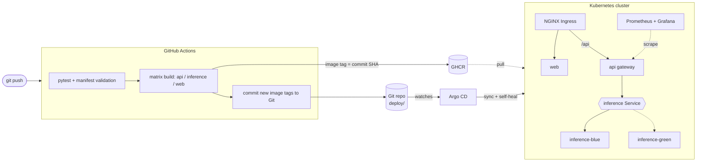

# GitOps Kubernetes Platform

[](https://github.com/onsgharbii/gitops-kubernetes-platform/actions/workflows/ci.yml)

An end-to-end delivery platform for a small ML application: **CI with GitHub Actions, GitOps with Argo CD, Kustomize environments, a Helm chart with Blue/Green releases, autoscaling and Prometheus/Grafana monitoring**. Everything runs locally on a `kind` cluster.

> This repository is a public, from-scratch rewrite of the delivery platform I built during my final-year internship at Smartovate (an AI agent platform on Azure Kubernetes Service and Amazon EKS). The original code is private. The application here is a deliberately simple stand-in, so that the focus stays on the platform.

## Architecture



| Service | Role | Stack |
|---|---|---|
| `web` | Static frontend | NGINX (unprivileged image) |
| `api` | Gateway, the only public API | FastAPI, Prometheus metrics |
| `inference` | Toy sentiment model, released Blue/Green | FastAPI, Helm |

## What it demonstrates

- **CI** ([ci.yml](.github/workflows/ci.yml)): unit tests and manifest validation on every PR, then parallel **matrix builds** of the 3 images, tagged with the **commit SHA** (each running pod can be traced back to its exact commit) and pushed to GitHub Container Registry with layer caching.
- **GitOps**: CI has **no access to the cluster**. It only commits the new image tags to `deploy/`. Argo CD detects the change and syncs, with automatic pruning and self-healing (manual changes in the cluster are reverted to what Git says).
- **Environments** with Kustomize: one `base`, two overlays. `dev` follows `main` automatically. `prod` runs 2 replicas with an HPA and is promoted on demand with [promote-prod.yml](.github/workflows/promote-prod.yml).
- **Blue/Green releases** for the inference service ([Helm chart](deploy/helm/inference), [release-inference.yml](.github/workflows/release-inference.yml)):
  1. `deploy`: the new version starts on the idle color, and live traffic is untouched.
  2. Test it through the `inference-preview` Service.
  3. `switch`: the live Service selector flips to the new color, with zero downtime.
  4. `cleanup`: the old color is removed. Before that, `switch` again is an instant rollback.

  The chart refuses invalid states (unknown color, or routing traffic to a color that is not deployed).
- **Hardened workloads**: non-root containers, read-only root filesystem, all Linux capabilities dropped, resource requests and limits, readiness and liveness probes, multi-stage Python images.
- **Observability**: kube-prometheus-stack, with the API's metrics scraped through a `ServiceMonitor`.
- **Least privilege in CI**: each job gets only the `GITHUB_TOKEN` permissions it needs (`packages: write` to build, `contents: write` to bump tags).

## Run it locally

Requirements: Docker, [kind](https://kind.sigs.k8s.io/), kubectl, Helm.

```bash
./scripts/bootstrap-kind.sh
```

This script:
- creates the cluster;
- installs NGINX Ingress, kube-prometheus-stack and Argo CD;
- registers the 4 Argo CD applications.

From then on, Argo CD deploys everything from Git. Open http://dev.localtest.me (`*.localtest.me` resolves to 127.0.0.1).

> The images are pulled from GHCR, so the packages must be public (GitHub → Packages → Package settings → Change visibility).

Run the tests without a cluster:

```bash
cd apps/api && pip install -r requirements-dev.txt && python -m pytest
```

## Repository layout

```text
apps/                       source code + Dockerfile of each service
deploy/
  kustomize/base/           api, web, ingress, ServiceMonitor
  kustomize/overlays/       dev / prod (namespace, replicas, HPA, image tags)
  helm/inference/           Blue/Green chart + values-dev / values-prod
  argocd/                   Argo CD Applications (one per component and environment)
  monitoring/               kube-prometheus-stack values
.github/workflows/          ci, promote-prod, release-inference
scripts/                    local kind cluster bootstrap
```

## Design choices

- **Argo CD rather than a `kubectl apply` step in CI**: the cluster pulls its desired state, so no cluster credentials live in CI, and drift is corrected automatically.
- **Kustomize for the simple services, Helm for the inference service**: overlays are enough to vary the environments. The Blue/Green logic (two deployments, a switchable selector, validation rules) is easier to express as a templated chart.
- **Commit SHA tags rather than `latest`**: every deployment is reproducible and auditable from the Git history.

## Possible next steps

- Sign images and scan them (cosign, Trivy) in CI
- External Secrets Operator for secrets management
- Argo Rollouts to automate the Blue/Green analysis
- Terraform for the cloud version of the cluster (AKS / EKS)

## Author

**Ons Gharbi**, Cloud & DevOps engineer. [LinkedIn](https://www.linkedin.com/in/ons-gharbi-8640852a7)
